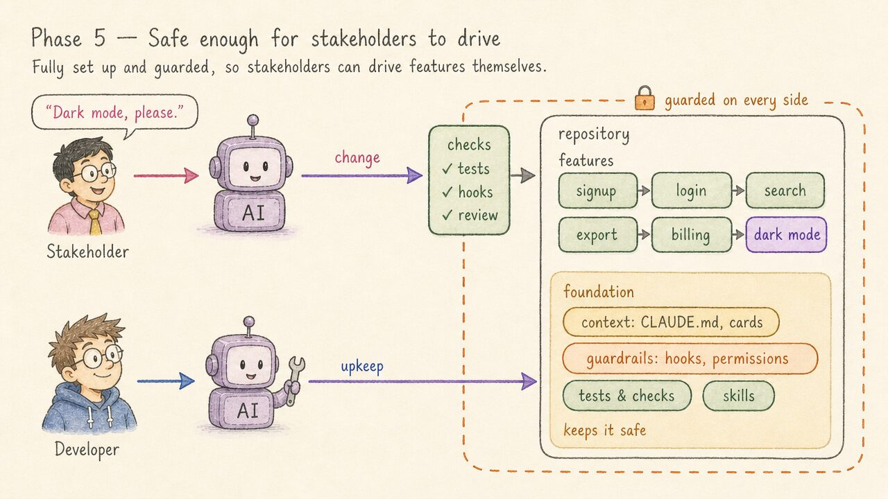

<a href="https://claude.ai"></a>

<a href="https://epatel.github.io/ai-phases/"></a>

# The Five Phases of AI Adoption in a Project

A blog post about five phases a software project goes through as AI agents move in: from typing every line yourself to stakeholders driving features inside a project that's guarded well enough for it.

**Read it here: [epatel.github.io/ai-phases](https://epatel.github.io/ai-phases/)**

| Phase | What changes |
|---|---|
| 1. Nothing added | The developer types every line; the repository holds only code. |
| 2. The developer prompts an AI | An agent writes the code, but the context lives in the developer's head and is retyped every session. |
| 3. AI context in the project | Context docs and tests move into the repo, so every agent session — and every parallel agent — starts from the same facts. |
| 4. Architecture chosen for AI | The developer picks designs that suit how an AI works, and code quality is measured. |
| 5. Safe enough for stakeholders to drive | Once that setup has been seen to hold, stakeholders drive features and the developer looks after the system. |

Phases 4 and 5 are a forecast, not a report: most teams are in phase 2 today, some in phase 3.

## What's in this repo

The post, its illustrations, and the agent setup used to write it. The repo itself sits in phase 3: `CLAUDE.md`, context cards and a project plan keep each Claude Code session on track.

| Path | What it is |
|---|---|
| `blog-post.md` | The post — the single source. |
| `blog-post.html` | Generated from the markdown (`make html`); never edited by hand. |
| `images/concept-2/` | The illustrations: PNG masters, the JPGs the post uses, and the SVG "meaning" diagrams they were drawn from. |
| `images/concept-1/` | The earlier comic-style concept, kept for reference (also at tag `concept-1`). |
| `CLAUDE.md`, `cards/`, `project-plan.md` | Context for the coding agent: commands, working rules, how the pieces fit, decisions and open items. |
| `ASSESSMENT.md` | The latest editorial review of the post. |
| `scripts/` | The markdown → HTML generator (Python standard library only), page template and link checker. |

## Building

```bash
make            # list targets
make html       # build blog-post.html from blog-post.md
make check      # rebuild, verify images and links, run the agent-docs checker
make jpg        # make the published JPGs from the PNG masters
make site       # assemble the GitHub Pages site in _site/
```

`make previews`, `make refs` and `make screenshot` need `rsvg-convert`, ImageMagick and Google Chrome. The page is deployed by `.github/workflows/pages.yml`; `make deploy` starts it on `main`.

## How the illustrations were made

Each phase was first drawn as a plain SVG diagram (`images/concept-2/diagrams/make_concept.py`) to pin down what it means. The diagram was then turned into a hand-drawn illustration with [ElevenLabs](https://elevenlabs.io) (`gpt-image-2`), using the phase 2 illustration as the style reference. The full pipeline is in [`cards/illustration-pipeline.md`](cards/illustration-pipeline.md).

## Getting started on your own project

The patterns from phase 3 are collected at [ai.memention.net/setup](https://ai.memention.net/setup). It's one way to do it, written for your agent: open your coding agent in your project and tell it `Follow https://ai.memention.net/setup`.
