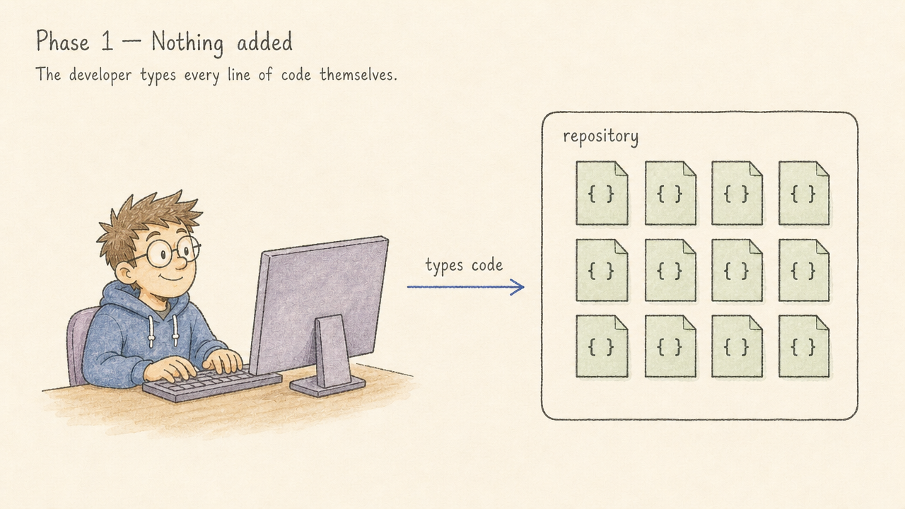
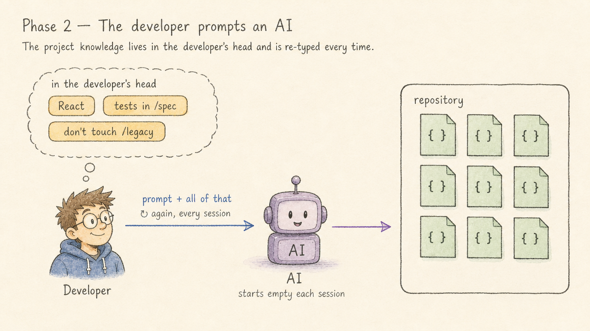

# The Five Phases of AI Adoption in a Project

Most teams don't decide to "adopt AI" in one go. It happens gradually, and the project itself changes along the way. I think of it as five phases. Each one changes what the AI knows, how the code is shaped, who drives the changes, and what the developer spends their day on.

From what I see, most teams are in phase 2 today. Some have reached phase 3. Phases 4 and 5 I have yet to see in practice; few have tried it yet. So read the first three as a map of where teams are now, and the last two as where I think this is heading.

---

## Phase 1: Nothing added

This is where every project starts. The developer types every line of code themselves. Maybe there's autocomplete in the editor, but nothing in the project knows or cares that AI exists. The repository holds source code and nothing else.

There's nothing wrong with this phase. It's just the baseline.

---

## Phase 2: The developer prompts an AI

Now an AI agent sits between the developer and the code. The developer describes a change, the agent makes it, and the developer reviews the result.

The catch is that **all the context lives in the developer's head** and has to be typed again in every prompt. Each session starts from zero: "We use this framework, tests are run like this, don't touch that folder…" It works, but it doesn't scale, and the quality of the output depends on how well the developer remembers to explain things that day.

---

## Phase 3: AI context in the project

The natural fix for phase 2 is to write the context down *in the project*. The repository now holds a small set of documents written for the agent, not for humans: what the project is, how to build and test it, conventions, and the things that are easy to get wrong.

In my own projects that means files like these (one way to do it):

- **`CLAUDE.md` / `AGENTS.md`**: the project overview, the commands, and an index of where to find more.
- **[Context cards](https://ai.memention.net/cards/cards-instructions.md)** (`cards/`): small, lazy-loaded notes the agent reads only when the situation calls for them, so the main file stays short.
- **[`project-plan.md`](https://ai.memention.net/cards/project-plan.md)**: one shared file with the goal, non-goals, milestones, decisions and current state, which every agent session reads and updates.
- **[Standing defaults](https://ai.memention.net/cards/standing-defaults.md)**: decisions made once (e.g. "always use a Python venv") so they aren't debated again in every session.
- **Project-scoped [skills](https://github.com/epatel/agent-skills/)** (`.claude/skills/`): repeatable workflows such as refactoring or reviews, checked into the repo so every agent and collaborator gets them.

The names are Claude Code's; other agents use `AGENTS.md` and similar files.

The application code itself hasn't changed yet. What changed is that the agent now starts every session already knowing the project. Prompts get shorter, and the results get more consistent.

Tests belong in this phase too, whether they're new or already there. Once the commands to run the unit and function tests are in the context docs, the agent checks that its change works before you look at it. Context tells the agent what to do; tests tell it whether it did.

This matters even more once you run more than one agent. If you orchestrate several agents in parallel, each in its own git worktree, none of them can borrow the context from your head. What's written in the repository comes along with every checkout, so each agent starts from the same conventions, commands and plan, and the decisions one agent records reach the others when its branch is merged. In phase 2, every extra agent means another long prompt; in phase 3, it's a short one.

> **Try it on your repo** If you want a quick look at your own agent docs, my [setup page](https://ai.memention.net/setup) includes a small read-only script, `check-agent-docs.py`. It flags broken `@` imports, dead or missing card index entries, and files that have grown too large, and it changes nothing.

---

## Phase 4: Architecture chosen for AI

From here on I'm looking ahead, so read this as suggestions rather than a report; the pieces exist today. In phase 3 the documentation adapted to the agent. In phase 4 I'd expect **the developer to start choosing the architecture for it**. Most of these choices are good for human developers too; the difference is that how an AI works becomes the tie-breaker whenever there's a design decision to make.

The trades I'd try first:

- **Prefer small features with clear hooks** over one big shared module. If each [feature is a pipeline](https://ai.memention.net/cards/feature-first-structured.md) of named steps with hook points, an agent can add behaviour without understanding the whole system.
- **Enforce rules with hooks** rather than writing them in docs. Mechanical "always/never" rules can [move out of the prose](https://ai.memention.net/cards/hooks-over-prose.md) and into `.claude/settings.json` permissions and hooks. Then the harness enforces them, and the agent doesn't have to remember them.
- **Give each feature an explicit contract** instead of relying on conventions in people's heads. For example, a `CLAUDE.md` per feature with its steps and hooks, [split into a short overview and a full contract](https://ai.memention.net/cards/two-tier-claude-md.md) once it grows.
- **Measure code quality, not just correctness.** The tests from phase 3 say whether a change works; measurements such as complexity, duplication, coverage and dependency rules say whether the structure is holding up. Keep the tests fast enough to run after every change, and turn the quality thresholds into checks the agent sees, so it corrects drift as it goes instead of leaving it for you.

My bet is that a well-structured project gives an agent less room to make mistakes.

---

## Phase 5: Safe enough for stakeholders to drive

This is the phase where the developer would stop adding features, and the one that takes the most nerve. It's the furthest out, so this is my guess at what it takes. It only works once the project is **fully set up and safe**, and you've seen that setup hold: the context is complete, the rules are enforced by hooks and permissions, and every change passes the tests and quality checks from the earlier phases on its way in. If a project is guarded that well, **the people who want features could drive them directly**. A stakeholder would work with their own AI session against the same project, inside the same guardrails, and features would come out the other end.

Review is the part I'd expect to have to scale. If the developer read every stakeholder change, they would simply become the bottleneck again, one pull request at a time. What I'd try is a second AI that reviews each change against the project's rules, alongside the tests and hooks, with a human stepping in only when the reviewer or a check flags something.

The developer doesn't disappear in this picture. They move to the other lane, from building features to looking after the system, with their AI pointed at the **AI layer and the project's health**:

- keeping the context documents and cards accurate as the code changes,
- tightening hooks, permissions and the reviewer's rules when an agent does something it shouldn't,
- refactoring where the quality measurements show the structure starting to drift,
- improving the tests and checks that let stakeholder-driven changes land safely,
- reviewing and auditing the agentic setup itself.

In short, the developer stops being the bottleneck for features and becomes the steward of the system that produces them.

---

## Where is your project?

A quick way to place a project:

| Phase | Signal |
|---|---|
| 1 | No AI tooling touches the repo |
| 2 | You use an agent, but you explain the project again in every prompt |
| 3 | There's a `CLAUDE.md`/`AGENTS.md`, the agent "knows" the project and runs the tests itself |
| 4 | Architecture decisions are made with the agent in mind, and code quality is measured |
| 5 | The project is safe enough that non-developers could ship features; developers mostly work on its health |

You don't have to rush, and different parts of a codebase can sit at different stages. If you're in phase 2, you're in good company: that's where most teams are. Writing your context down is a step almost any team can take today, and each step makes the next one possible. I'd expect stakeholder-driven work to hold up only on top of the context and guardrails that come before it.

None of this is free. Each step costs setup time and ongoing upkeep: context goes stale, hooks need tuning, and agents spend tokens reading it all. The last phase also widens who can trigger changes, so the guardrails would have to be treated like security controls, not conventions. That's a good reason to take the phases one at a time.

## Getting started

If you want somewhere to start, I've collected the patterns, files and skills I use myself at **[ai.memention.net/setup](https://ai.memention.net/setup)**. It's one way to do it, not the way: treat it as an example or a starting point, take what fits your project and change the rest. It covers context cards, the shared project plan, standing defaults, feature-first documentation, hooks over prose and project-scoped skills.

The page is written for your agent, not for you. If you'd like to try it, open your coding agent in the project and tell it: `Follow https://ai.memention.net/setup`. It looks at the repo, suggests which patterns might fit, and asks before applying anything. You can run it again later to pick up changes.
