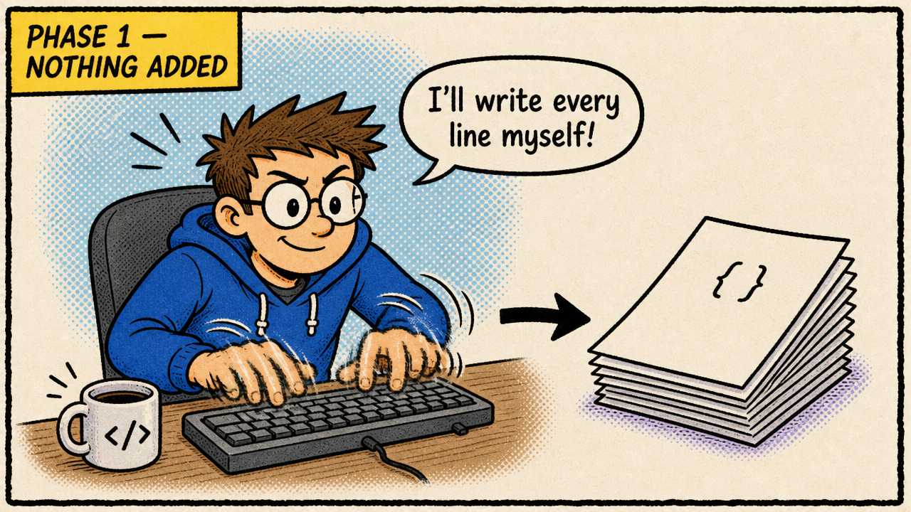
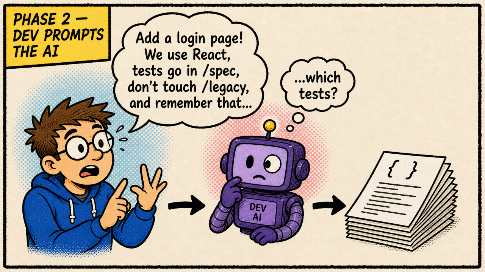
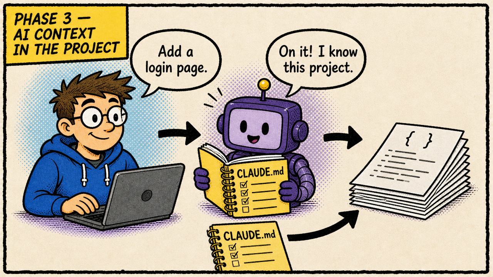
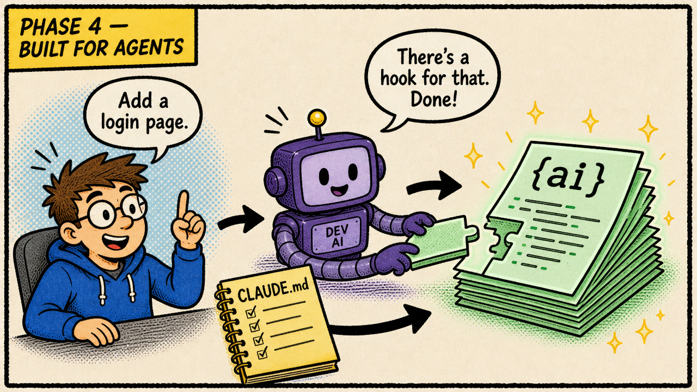
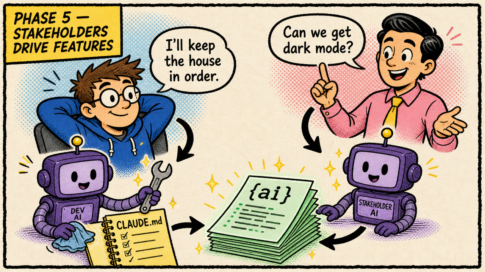

# The Five Phases of AI Adoption in a Project

Most teams don't decide to "adopt AI" in one go. It happens gradually, and the project itself changes along the way. I think of it as five phases. Each one changes who touches the code, what touches it, and what the developer spends their day on.

From what I see, most teams are in phase 2 today. Some have reached phase 3. Phases 4 and 5 I have yet to see in practice; few dare to go there yet. So read the first three as a map of where teams are now, and the last two as where I think this is heading.

Here they are, with a comic panel for each.

---

## Phase 1: Nothing added

This is where every project starts. The developer writes the code by hand. Maybe there's autocomplete in the editor, but nothing in the project knows or cares that AI exists. The repository holds source code and nothing else.

There's nothing wrong with this phase. It's just the baseline.

---

## Phase 2: The developer writes prompts that edit the project

Now an AI sits between the developer's hands and the code. The developer describes a change, the agent makes it, and the developer reviews the result.

The catch is that **all the context lives in the developer's head** and has to be typed again in every prompt. Each session starts from zero: "We use this framework, tests are run like this, don't touch that folder…" It works, but it doesn't scale, and the quality of the output depends on how well the developer remembers to explain things that day.

---

## Phase 3: AI context engineering is scaffolded into the project

The obvious fix for phase 2 is to write the context down *in the project*. The repository now holds a small set of documents written for the agent, not for humans: what the project is, how to build and test it, conventions, and the things that are easy to get wrong.

In practice this means files like:

- **`CLAUDE.md` / `AGENTS.md`**: the project overview, the commands, and an index of where to find more.
- **Context cards** (`cards/`): small, lazy-loaded notes the agent reads only when the situation calls for them, so the main file stays short.
- **`project-plan.md`**: one shared file with the goal, non-goals, milestones, decisions and current state, which every agent session reads and updates.
- **Standing defaults**: decisions made once (e.g. "always use a Python venv") so they aren't debated again in every session.

The code hasn't changed yet. What changed is that the agent now starts every session already knowing the project. Prompts get shorter, and the results get more consistent.

---

## Phase 4: The project is architected for agentic tools

From here on, we're looking ahead. I haven't seen a team fully here yet, but the pieces exist today. In phase 3 the documentation adapted to the agent. In phase 4 **the code itself adapts**. Note how the code pages change from `{ }` to `{ai}`.

This is when you start making structural choices because they make the code easier for an agent to read and change safely:

- **Feature-first architecture**: features are documented as pipelines of named steps with clear hook points, so an agent can add behaviour without having to understand the whole system.
- **Per-feature `CLAUDE.md` files**, split into a short overview and a full contract (`CLAUDE_full.md`) once they grow too long.
- **Hooks over prose**: mechanical "always/never" rules move out of the documentation and into `.claude/settings.json` permissions and hooks. The harness enforces them, so the agent doesn't have to remember them.
- **Project-scoped skills** in `.claude/skills/`: repeatable workflows (refactoring, reviews, releases) checked into the repo, so every collaborator and worktree gets them.

The guiding idea is that a well-structured project gives an agent less room to make mistakes. Clear boundaries, enforced rules and documented extension points help human developers too.

---

## Phase 5: The developer stops adding features

This is the phase that changes the role, and the one that takes the most nerve. Letting people outside the dev team drive changes takes trust in the guardrails, and few projects have earned that yet. But once the project can carry its own context and its structure guides the agent, **the people who want features can ask for them directly**. A stakeholder works with their own AI session against the same project, the same context documents and the same guardrails, and features come out the other end.

The developer doesn't disappear. They move to another part of the panel. Their AI now points at the **AI layer and the project's health**:

- keeping the context documents and cards accurate as the code changes,
- tightening hooks and permissions when an agent does something it shouldn't,
- refactoring where the structure has started to drift,
- improving the tests and checks that let stakeholder-driven changes land safely,
- reviewing and auditing the agentic setup itself.

In short, the developer stops being the bottleneck for features and becomes the steward of the system that produces them.

---

## Where is your project?

A quick way to place a project:

| Phase | Signal |
|---|---|
| 1 | No AI tooling touches the repo |
| 2 | You use an agent, but you explain the project again in every prompt |
| 3 | There's a `CLAUDE.md`/`AGENTS.md` and the agent "knows" the project |
| 4 | Structure, hooks and skills are designed with the agent in mind |
| 5 | Non-developers ship features; developers mostly work on the project's health |

You don't have to rush through them, and different parts of a codebase can be in different phases. If you're in phase 2, you're in good company: that's where most teams are. Phase 3 is the step almost any team can take today, and each step makes the next one possible. Phase 5 doesn't work without the context of phase 3 and the guardrails of phase 4.

## Getting started

If you want to move a project from phase 2 to phase 3 or 4, I've collected the patterns, files and skills I use at **[ai.memention.net/setup](https://ai.memention.net/setup)**. It covers context cards, the shared project plan, standing defaults, feature-first documentation, hooks over prose, project-scoped skills, and a read-only checker you can run against your repo to see where it stands.

The page is written for your agent, not for you. Open your coding agent in the project and tell it: `Follow https://ai.memention.net/setup`. It assesses the repo, recommends which patterns fit, and asks before applying anything. Run it again later to pick up what's new.
