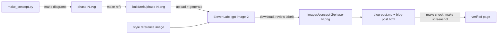

# architecture

How the project's files fit together: the post text, the HTML preview, and where every image comes from.

## Files

| Path | What it is |
|---|---|
| `blog-post.md` | The post. Frontmatter (title, date, author), five phase sections, a "Where is your project?" table, "Getting started". |
| `blog-post.html` | Standalone preview of the same text with styling, a phase nav, a callout and a call-to-action box. Hand-maintained alongside the markdown. |
| `images/concept-2/phase-1..5.png` | The illustrations the post uses (1280×720, ElevenLabs `gpt-image-2`). |
| `images/concept-2/diagrams/` | `make_concept.py` and the SVG "meaning" diagrams it writes; the layout reference for each illustration. |
| `images/concept-2/first-take/` | Superseded first versions of phases 1, 4 and 5. |
| `images/concept-1/` | Archive of the first concept: `comic/` (ElevenLabs comic panels), `code-drawn/` (SVG-rendered comics), `style-2-phase-5.png` (a softer comic test). |
| `ASSESSMENT.md` | Editorial review of the post, with numbered issues. |
| `project-plan.md` | Goal, milestones, decisions and open items. |
| `Makefile`, `scripts/check_post.py` | Rendering, checks and screenshots. |
| `ai-phases.pdf`, `initial-idea.md` | The author's original hand sketches and brief. Git-ignored, local only. |
| `build/` | Generated previews, refs and screenshots. Git-ignored. |

## How an illustration gets made

## Git

- Work happens on branch `blog-post`; `main` holds only the initial commit.
- Tags `style-1` and `concept-1` both point at the commit with the comic (concept 1) version of the post.
